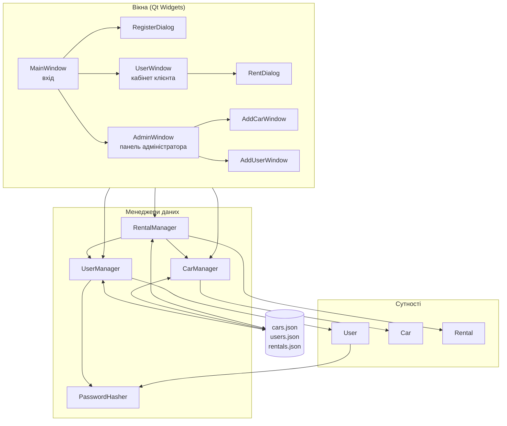

# 🚗 CarRental — облік автомобілів автопрокату

Віконний застосунок на **C++17 / Qt 6 (Widgets)** для обліку автомобілів автопрокату: каталог авто з фільтрами й сортуванням, оформлення та повернення оренди, керування автопарком і користувачами, експорт даних у CSV.

> Курсова робота з дисципліни «Об’єктно-орієнтоване програмування»
> Національний університет «Львівська політехніка», кафедра програмного забезпечення
> Виконав: **Пущак Андрій**, група ПЗ-24 · Керівник: асистент кафедри ПЗ, док. філософії **Паламарчук Д. Ю.** · 2026

---

## Зміст

- [Можливості](#можливості)
- [Завдання курсової та їх реалізація](#завдання-курсової-та-їх-реалізація)
- [Клас «Автомобіль прокату»](#клас-автомобіль-прокату)
- [Технології та системні вимоги](#технології-та-системні-вимоги)
- [Збирання і запуск](#збирання-і-запуск)
- [Перший вхід і обліковий запис адміністратора](#перший-вхід-і-обліковий-запис-адміністратора)
- [Файли даних](#файли-даних)
- [Архітектура](#архітектура)
- [Обробка помилок](#обробка-помилок)
- [Структура проєкту](#структура-проєкту)

---

## Можливості

### 👤 Гість
- Реєстрація нового облікового запису (ім’я, e-mail, пароль від 8 символів). Нові користувачі отримують роль «Користувач».

### 🧑 Орендар (клієнт)
- **Каталог доступних авто** у вигляді карток: марка, модель, клас, рік, кількість місць, пробіг, ціна за добу.
- **Фільтри:** клас, мінімальна кількість місць, максимальна ціна. Каталог оновлюється одразу після зміни значення.
- **Вартість оренди на N днів** на кожній картці.
- **Режими відображення:** сортування за ціною (злиттям), авто з мінімальним і максимальним пробігом, групування за класом і роком, кнопка «Скинути».
- **Бронювання:** подвійний клік по картці → вибір дат → підсумкова сума → підтвердження.
- **Мої бронювання:** скасування бронювання, яке ще не почалося, і повернення авто. За кожен прострочений день береться ціна за добу × 1,5.
- **Профіль:** особисті дані, зміна пароля, статистика (кількість оренд, активні, завершені, витрачена сума).

### 🛠️ Адміністратор
- **Автопарк:** фільтри за категорією, статусом, кількістю місць і ціною; ті самі режими сортування й групування, що й у клієнта.
- **Додавання та редагування авто** з перевіркою даних. Орендоване авто редагувати не можна.
- **Видалення авто:** авто не видаляється, а переводиться в архів.
- **Користувачі:** перегляд, додавання (з вибором ролі), видалення. Не можна видалити себе або користувача з активною орендою.
- **Бронювання:** таблиця всіх оренд.
- **Експорт у CSV** (меню «Файл»): користувачі, автомобілі, історія оренди.

---

## Завдання курсової та їх реалізація

| № | Завдання | Де в інтерфейсі | Реалізація |
|---|---|---|---|
| 1 | Пошук доступних автомобілів заданого класу | список «Клас» | `UserWindow::applyFilters`, `renderCatalog` |
| 2 | Авто з мінімальною кількістю місць і ціною, що не перевищує задану | поля «Мін. місць», «Макс. ціна» | `UserWindow::applyFilters`, `AdminWindow::applyFilters` |
| 3 | Вартість оренди кожного доступного авто на задану кількість днів | поле «Днів» | `UserWindow::createCarCardWidget` |
| 4 | Сортування доступних авто за вартістю оренди **методом злиття** | «Сортувати за ціною» (повторне натискання змінює напрямок) | `CarManager::mergeSort`, `CarManager::merge` |
| 5 | Усі авто з мінімальним і максимальним пробігом (з урахуванням однакових значень) | «Мін/Макс пробіг» | `CarManager::selectMinMaxMileage` |
| 6 | Групування за класом, усередині групи — за роком випуску | «Згрупувати (Клас + Рік)» | `CarManager::groupByClassYear` |

Завдання 4–6 реалізовані в `CarManager`, тому однаково працюють у кабінеті клієнта і в автопарку адміністратора. Поточний режим зберігається в перелічуваному типі `CatalogMode` (`None`, `SortPrice`, `MinMaxMileage`, `GroupClassYear`).

---

## Клас «Автомобіль прокату»

Клас `Car` (`car.h`, `car.cpp`) містить поля:

| Поле | Тип | Опис |
|---|---|---|
| `id` | `QString` | ідентифікатор `C-N` |
| `brand`, `model` | `QString` | марка, модель (не порожні) |
| `category` | `Category` | клас: Економ / Комфорт / Бізнес |
| `seats` | `int` | кількість місць (> 0) |
| `manufacturerYear` | `int` | рік випуску (1990 – поточний рік) |
| `rentPrice` | `double` | вартість оренди за добу, грн (≥ 0) |
| `mileage` | `double` | пробіг, км (≥ 0) |
| `status` | `Status` | Доступно / Зайнято / Недоступно / Архівовано |

Що реалізовано за вимогами завдання:
- **Конструктор за замовчуванням і з параметрами.** Це один конструктор зі значеннями параметрів за замовчуванням. Дані він перевіряє через сетери.
- **Конструктор переміщення та оператор переміщення** (`Car(Car&&) noexcept`, `operator=(Car&&) noexcept`).
- **Перевантажені операції `<<` і `>>`** для запису у файл і зчитування з файлу:
  - `QJsonObject << Car` і `QJsonObject >> Car` для збереження та завантаження JSON;
  - `QTextStream << Car` для експорту в CSV.

---

## Технології та системні вимоги

- **Мова:** C++17
- **Фреймворк:** Qt 6 (модуль Widgets). Збирання з Qt 5 теж передбачене в `CMakeLists.txt`
- **Збирання:** CMake ≥ 3.16
- **IDE:** Qt Creator
- **Зберігання даних:** JSON (`QJsonDocument`), експорт у CSV
- **Паролі:** SHA-256 із сіллю (`QCryptographicHash`)

| Компонент | Мінімум |
|---|---|
| ОС | Windows 10/11 (64-bit) або macOS 12+ |
| ОЗП | 4 ГБ |
| Диск | 100 МБ |
| Екран | 1280 × 720 |

---

## Збирання і запуск

### Qt Creator
1. Відкрити `CMakeLists.txt` через **File → Open File or Project**.
2. Вибрати комплект (kit) з Qt 6.
3. Натиснути **Run** (Ctrl + R).

### Командний рядок
```bash
git clone https://github.com/lopez1k/kursova.git
cd kursova
cmake -S . -B build -DCMAKE_PREFIX_PATH=<шлях до Qt>/6.x.x/<компілятор>
cmake --build build --config Release
```
Готовий виконуваний файл: `OOP_PZ24_Andrii_Pushchak` (`.exe` у Windows, `.app` у macOS).

Щоб запустити програму на Windows без встановленого Qt, біля `.exe` треба покласти бібліотеки Qt:
```bash
windeployqt build/Release/OOP_PZ24_Andrii_Pushchak.exe
```

---

## Перший вхід і обліковий запис адміністратора

1. Запустіть програму і натисніть **«Реєстрація»**. Створений акаунт отримає роль «Користувач».
2. Щоб зробити його адміністратором, закрийте програму і змініть у `users.json` поле `role` на `"Адміністратор"`:
   ```json
   { "id": "U-1", "name": "Андрій", "email": "admin@carrental.ua",
     "password": "<хеш>", "role": "Адміністратор" }
   ```
3. Після наступного входу відкриється **панель адміністратора**. Далі нових адміністраторів можна додавати з неї («Користувачі → Додати користувача»).

---

## Файли даних

Дані зберігаються в робочій папці програми у трьох JSON-файлах. Якщо файлів немає, вони створюються після першого збереження.

| Файл | Що містить | ID |
|---|---|---|
| `cars.json` | автомобілі | `C-N` |
| `users.json` | користувачі (пароль у вигляді хешу) | `U-N` |
| `rentals.json` | оренди | `R-N` |

**Приклад `cars.json`:**

```json
[
    {
        "brand": "Toyota",
        "category": "Комфорт",
        "id": "C-1",
        "manufacturerYear": 2021,
        "mileage": 45200,
        "model": "Camry",
        "rentPrice": 1800,
        "seats": 5,
        "status": "Доступно"
    }
]
```

**Приклад `rentals.json`:**

```json
[
    {
        "carId": "C-2",
        "endDate": "2026-11-20T23:59:00",
        "id": "R-1",
        "pricePerDay": 900,
        "returnedDate": "",
        "startDate": "2026-11-15T00:00:00",
        "status": "Активно",
        "totalPrice": 4500,
        "userId": "U-2"
    }
]
```

**Експорт у CSV** (меню «Файл» у панелі адміністратора): перший рядок містить заголовки, поля розділені `;`.
```csv
ID;Марка;Модель;Категорія;Рік випуску;Місць;Ціна оренди;Пробіг;Статус
C-1;Toyota;Camry;Комфорт;2021;5;1800;45200;Доступно
```

---

## Архітектура



- **Сутності** (`Car`, `User`, `Rental`) зберігають дані і перевіряють їх у сетерах.
- **Менеджери** зберігають списки сутностей у `QList`, виконують завдання 1–6, оформлюють оренду, працюють з файлами.
- **Вікна** відповідають лише за інтерфейс і викликають методи менеджерів. Менеджери створює `MainWindow` і передає їх іншим вікнам за вказівником.

---

## Обробка помилок

Власна ієрархія винятків на базі `std::runtime_error`. У вікнах достатньо перехопити `AppException`, і користувач побачить повідомлення з `what()`.

```
AppException
├── CarException
│   └── InvalidCarDataException          порожня марка/модель, некоректний рік, місця, ціна, пробіг
├── UserException
│   ├── UserNotFoundException            немає користувача з такою поштою
│   ├── UserNotFoundByIdException
│   ├── InvalidPasswordException         неправильний пароль
│   ├── PasswordTooShortException        пароль коротший за 8 символів
│   ├── InvalidNameException
│   ├── InvalidEmailException            неправильний формат e-mail
│   └── EmailAlreadyExistsException      пошта вже зареєстрована
└── RentalException
    ├── CarNotFoundException
    ├── CarNotAvailableException         авто вже орендоване або недоступне
    ├── InvalidRentalPeriodException
    ├── RentalNotFoundException
    └── RentalNotActiveException
```

Якщо файл даних відсутній або пошкоджений, програма не завершується аварійно, а запускається з порожнім списком.

---

## Структура проєкту

| Файли | Призначення |
|---|---|
| `main.cpp` | точка входу |
| `car.*`, `user.*`, `rental.*` | сутності: автомобіль, користувач, оренда |
| `carmanager.*` | список авто, JSON, експорт CSV, сортування злиттям, мін./макс. пробіг, групування, `CatalogMode` |
| `usermanager.*` | реєстрація, вхід, зміна пароля, користувачі |
| `rentalmanager.*` | оформлення, повернення і скасування оренди |
| `passwordhasher.*` | хешування паролів (SHA-256 + сіль) |
| `appexception.*`, `carexception.*`, `userexception.*`, `rentalexception.*` | ієрархія винятків |
| `mainwindow.*` | вікно входу |
| `registerdialog.*` | реєстрація |
| `userwindow.*` | кабінет клієнта: каталог, бронювання, профіль |
| `rentdialog.*` | діалог оформлення бронювання |
| `adminwindow.*` | панель адміністратора |
| `addcarwindow.*` | додавання / редагування авто |
| `adduserwindow.*` | додавання користувача |
| `resources.qrc`, `logo.png` | ресурси (логотип) |
| `CMakeLists.txt` | конфігурація збирання |